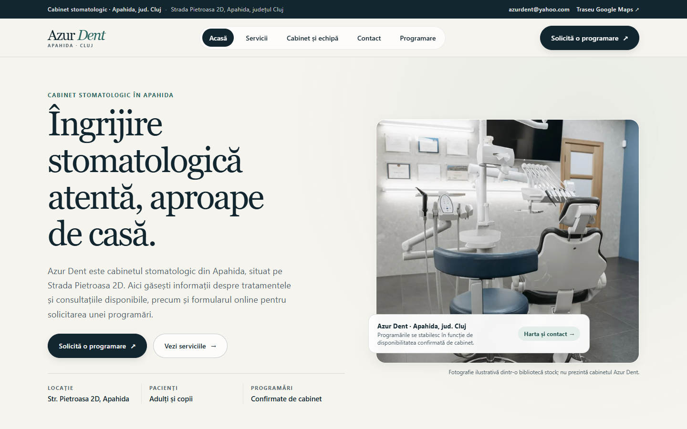
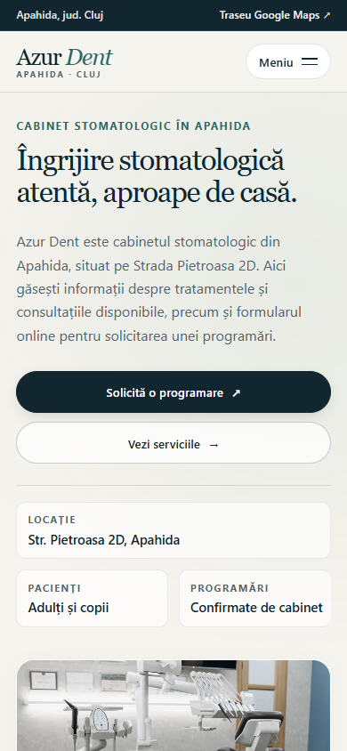
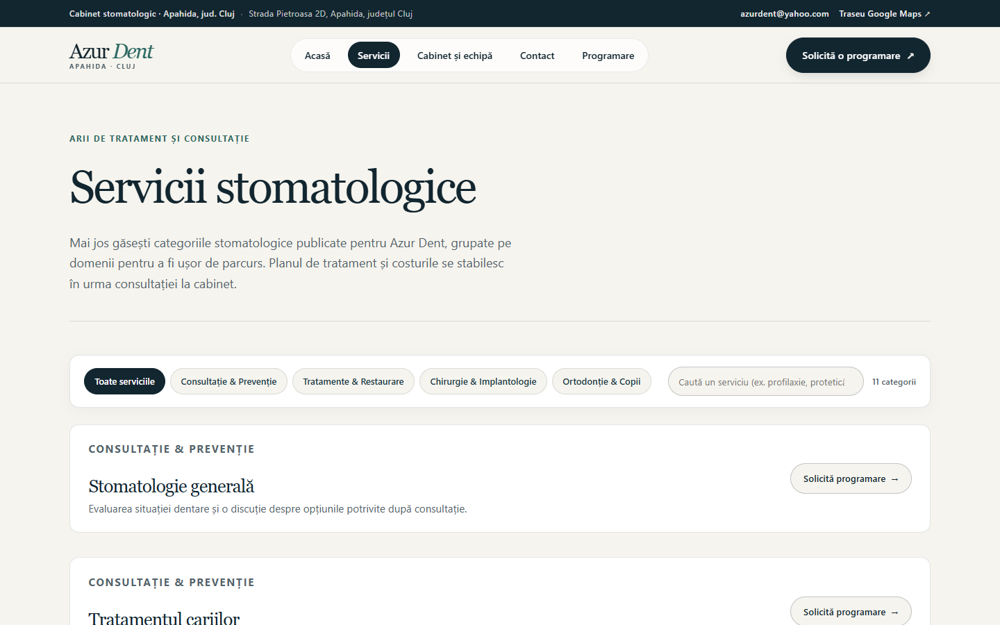
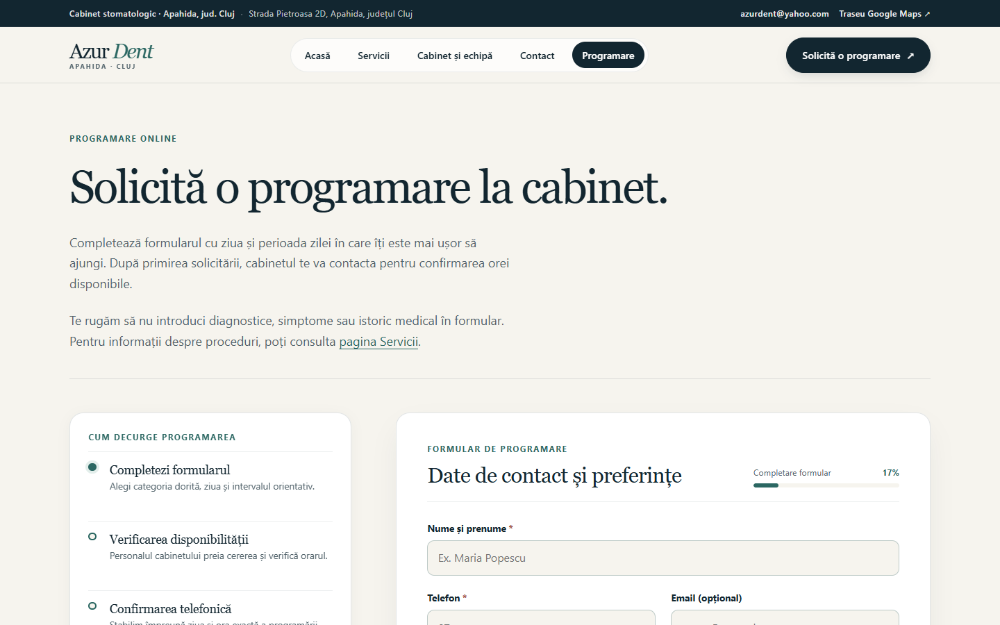
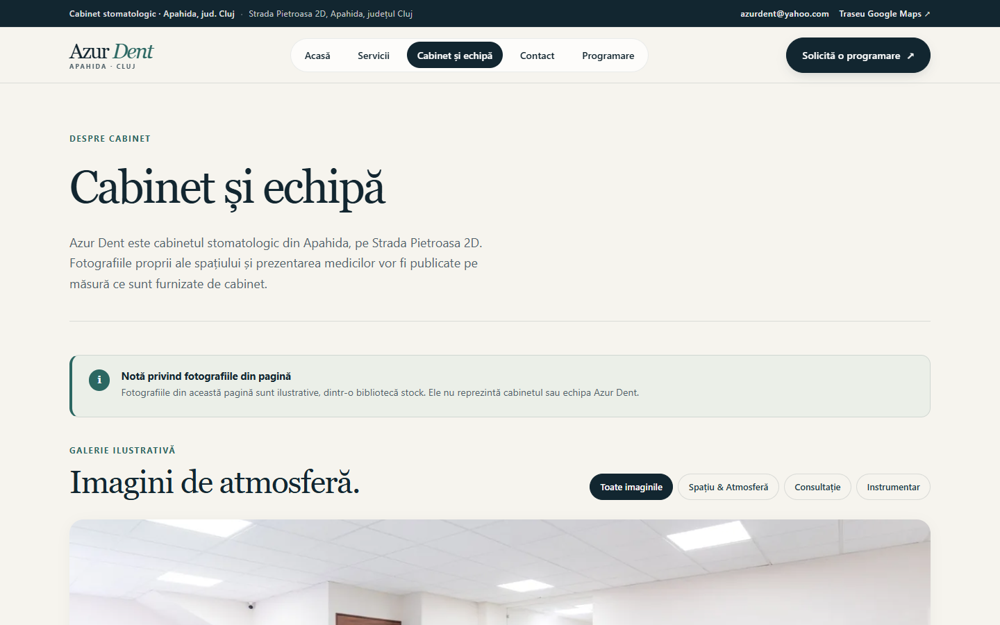
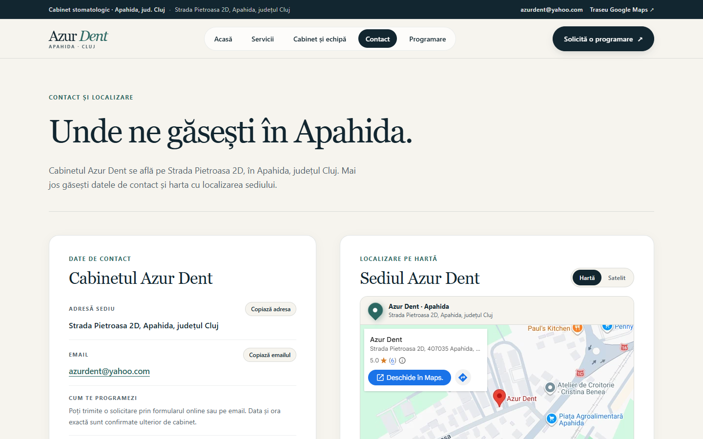

<h1 align="center">Azur Dent</h1>

<p align="center"><strong>Temă WordPress pentru un cabinet stomatologic din Apahida, județul Cluj.</strong></p>
<p align="center">WordPress · Gutenberg · PHP · design responsive</p>

<p align="center">
  <a href="#capturi-de-ecran">Capturi</a> ·
  <a href="#instalare">Instalare</a> ·
  <a href="#configurare">Configurare</a> ·
  <a href="#english">English</a>
</p>

<p align="center">
  
</p>

## Capturi de ecran

<p align="center">
  <strong>Acasă — afișare mobilă</strong><br>
  
</p>

| Servicii | Formular de programare |
|---|---|
|  |  |

| Cabinet și echipă | Contact |
|---|---|
|  |  |

Vezi [toate capturile incluse](docs/screenshots/).

## Despre proiect

Azur Dent este o temă WordPress clasică, instalabilă și pregătită pentru editorul Gutenberg. La activare, creează paginile și meniurile care lipsesc și setează pagina Acasă ca pagină principală. Conținutul rămâne editabil din panoul WordPress.

### Pagini incluse

- **Acasă** — prezentarea cabinetului, servicii reprezentative și acces rapid la programare.
- **Servicii** — categorii de servicii și căutare/filtrare în listă.
- **Cabinet și echipă** — galerie foto cu filtre și lightbox; imaginile stock sunt marcate ca ilustrative.
- **Programare** — formular pentru solicitarea unei programări, cu rezumat înainte de trimitere.
- **Contact** — adresă, email și link de traseu.
- **Confidențialitate** — informare legată de prelucrarea solicitărilor.

### Funcții

- navigație responsive, meniu mobil accesibil și antet sticky;
- formular server-side cu validare, nonce WordPress, honeypot și limitarea trimiterilor;
- emailul de notificare este editabil din **Aspect → Setări Azur Dent**;
- solicitările nu sunt păstrate în baza de date WordPress;
- galerie cu navigare prin tastatură și suport pentru atingere;
- date SEO, Open Graph și date structurate locale, bazate pe informațiile disponibile;
- JavaScript și CSS încărcate prin WordPress, fără framework-uri externe.

## Instalare

Pachetul gata de încărcat este [**azur-dent-theme.zip**](azur-dent-theme.zip).

1. În panoul WordPress, mergi la **Aspect → Teme → Adaugă o temă → Încarcă o temă**.
2. Alege arhiva `azur-dent-theme.zip`, apoi instalează și activează tema.
3. Verifică paginile create și editează conținutul folosind blocurile Gutenberg.

Pentru instalare manuală, copiază folderul `theme/azur-dent/` în `wp-content/themes/` și activează tema din panoul WordPress.

**Cerințe:** WordPress 6.6 sau mai nou și PHP 7.4 sau mai nou.

## Configurare

În **Aspect → Setări Azur Dent** poți modifica adresa, emailul, telefonul și identitatea operatorului.

Înainte de publicarea pe un domeniu real:

- confirmă adresa de email și configurează SMTP dacă serverul de hosting nu livrează emailuri prin `wp_mail()`;
- telefonul este lăsat necompletat până la confirmarea numărului actual, deoarece sursele publice consultate afișează valori diferite;
- completează identitatea juridică a operatorului și perioada de păstrare în informarea de confidențialitate;
- confirmă serviciile și datele de contact cu cabinetul;
- înlocuiește fotografiile stock cu fotografii proprii doar după aprobarea cabinetului.

Formularul transmite o **solicitare**; nu rezervă automat un interval. Un mesaj de succes indică faptul că WordPress a predat emailul serviciului de trimitere, nu confirmă livrarea în inbox și nici programarea. Verifică livrarea reală după configurarea SMTP.

Formularul colectează doar date de contact și preferințe de programare; nu solicită diagnostic, simptome sau istoric medical și nu stochează solicitarea în WordPress.

## Previzualizare locală

Cu Node.js 20.18 sau mai nou, poți porni WordPress Playground direct din folderul temei:

```bash
cd theme/azur-dent
npx @wp-playground/cli@latest start
```

Playground CLI furnizează instanța WordPress locală și montează automat tema.

## Structura repo-ului

```text
.
├── docs/screenshots/       # capturi desktop și mobil
├── theme/azur-dent/        # tema WordPress
├── azur-dent-theme.zip     # arhiva instalabilă
├── IMPLEMENTATION_PLAN.md # planul și notele proiectului
└── SOURCES.md              # surse publice și creditele fotografiilor
```

Cele opt fotografii incluse sunt imagini stock Pexels, optimizate în WebP la lățimi responsive. Ele nu reprezintă cabinetul sau echipa Azur Dent. Vezi [SOURCES.md](SOURCES.md) pentru credite și surse.

---

<a id="english"></a>
## English

**Azur Dent** is an installable, Gutenberg-ready WordPress theme for a dental clinic in Apahida, Cluj County, Romania. The theme creates the missing site pages and menus on activation while keeping page content editable in WordPress.

### Highlights

- Six pages: Home, Services, Clinic & Team, Appointment Request, Contact, and Privacy.
- Responsive navigation, service filters, photo gallery with an accessible lightbox, and appointment form summary.
- Server-side appointment request handling with WordPress nonce validation, a honeypot field, and rate limiting.
- Requests are emailed with `wp_mail()` and are not stored in the WordPress database.
- Eight responsive Pexels stock photos in WebP format. They are illustrative and do not depict the actual clinic or team.

### Install

Upload [**azur-dent-theme.zip**](azur-dent-theme.zip) from **Appearance → Themes → Add New → Upload Theme**, then activate it. Requires WordPress 6.6+ and PHP 7.4+.

Before going live, confirm the clinic's phone number and email, configure SMTP and verify delivery, complete the legal operator details in the privacy notice, and confirm the listed services. The form sends an appointment request; the clinic confirms availability separately.

See [SOURCES.md](SOURCES.md) for public information sources and photo credits. For local development, run `npx @wp-playground/cli@latest start` from `theme/azur-dent/`.
